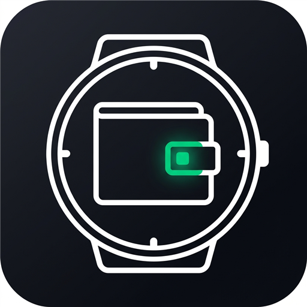
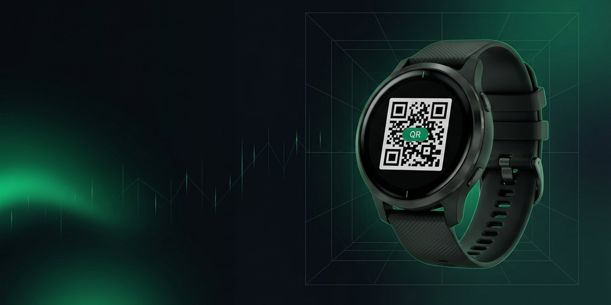

<div align="center">



# Universal WristPay

**Aplikasi QRIS portabel langsung di pergelangan tangan Anda.**
Tampilkan QRIS Statis maupun QRIS Nominal (Dinamis) secara offline di Garmin Forerunner 165 —
cepat, praktis, tanpa koneksi internet dan tanpa server pihak ketiga.

[](https://developer.garmin.com/connect-iq/overview/)
[](https://developer.garmin.com/connect-iq/monkey-c/)
[](https://www.garmin.com)
[](https://www.bi.go.id)
[](#cara-kerja)

[PRD](./PRD.md) · [Cara Setup QRIS](#cara-memasukkan-qris-anda) · [Laporkan Bug](https://github.com/razannnnnn/garmin-terima-qris/issues)

</div>

---

## Daftar Isi

- [Kenapa proyek ini](#kenapa-proyek-ini)
- [Fitur](#fitur)
- [Tangkapan Layar](#tangkapan-layar)
- [Cara Kerja](#cara-kerja)
- [Stack & Arsitektur](#stack--arsitektur)
- [Mulai Menjalankan](#mulai-menjalankan)
- [Cara Memasukkan QRIS Anda](#cara-memasukkan-qris-anda)
- [Struktur Proyek](#struktur-proyek)
- [Keamanan & Privasi](#keamanan--privasi)
- [Pemecahan Masalah](#pemecahan-masalah)
- [Keterbatasan](#keterbatasan)
- [Disclaimer](#disclaimer)

---

## Kenapa proyek ini

Saat menerima pembayaran QRIS di situasi santai — habis lari bareng, beli minum di pinggir jalan, atau patungan makan — mengeluarkan HP hanya untuk membuka aplikasi e-wallet atau mencari foto QRIS sering merepotkan. **Universal WristPay** (`garmin-terima-qris`) menyimpan payload QRIS statis milik Anda langsung di jam Garmin, lalu memproses dan me-render kode QR-nya secara lokal.

Butuh nominal spesifik? Cukup geser layar, pilih kelipatan nominal dengan satu jari, dan QRIS dengan nominal (`Tag 54`) langsung terbentuk lengkap dengan kalkulasi ulang `CRC16` — **100% offline di jam**.

## Fitur

<table>
<tr>
<td width="50%" valign="top">

**📱 QRIS Statis Instan**
Halaman utama langsung menampilkan QR merchant aktif.
- Langsung muncul saat aplikasi dibuka (`a.n. <MERCHANT>`)
- Mendukung hingga **5 slot merchant** berbeda
- Navigasi **Touch Swipe** & tombol fisik **`UP`/`DOWN`**
- Cocok untuk pembayaran cepat tanpa input nominal

</td>
<td width="50%" valign="top">

**🔢 Pemilih Nominal Stepper**
Input nominal ramah jempol di layar bulat 390×390.
- Tombol besar **`+` / `-`** dengan kelipatan **`500`**, **`1rb`**, **`5rb`**, **`10rb`**
- Tombol reset **`C`** dan **`TAMPILKAN QR`**
- Menu cepat (**`Menu2`**) untuk nominal *preset*
- Tampilan QR Dinamis lengkap dengan tombol **`Selesai`**

</td>
</tr>
<tr>
<td width="50%" valign="top">

**⚙️ Engine EMVCo / QRIS**
Validasi & injeksi nominal sesuai standar QRIS.
- Parsing TLV ketat (`00`–`63`) & verifikasi **CRC16-CCITT (False)**
- Validasi mata uang IDR (`53 = 360`), negara (`58 = ID`), & akun merchant (`26`–`45` / `51`)
- Menolak payload rusak atau tag tip/biaya (`55`–`57`) saat injeksi nominal
- Menyisipkan `Tag 54`, memperbarui `Tag 01` (`12` atau `11`), & hitung ulang `Tag 63`

</td>
<td width="50%" valign="top">

**🧩 Encoder QR Murni Monkey C**
Render kode QR langsung di perangkat tanpa internet.
- Implementasi mandiri **QR Model 2** (Byte mode, ECC Level L, Versi 1–12)
- Pemrosesan bertahap dengan **`Timer` 50ms** agar aman dari batas Watchdog Connect IQ
- Sinkronisasi pengaturan merchant otomatis dari HP via `onSettingsChanged()`
- Riwayat lokal **`QR Dibuat`** (maksimal 20 entri)

</td>
</tr>
</table>

## Tangkapan Layar

<div align="center">
  
</div>

<br />

<table>
<tr>
<td width="33%" align="center">
  
  <br /><sub><b>Halaman 1 — QRIS Statis</b></sub>
</td>
<td width="33%" align="center">
  
  <br /><sub><b>Halaman 2 — Stepper Nominal</b></sub>
</td>
<td width="33%" align="center">
  
  <br /><sub><b>Tampilan QR Dinamis</b></sub>
</td>
</tr>
</table>

## Cara Kerja

```text
HP (Connect IQ App) ──► onSettingsChanged() ──► MerchantStore (validasi & simpan 5 slot)
                                                       │
Jam (Halaman 1)     ──► StaticQrView        ──► QrEncoder (Timer 50ms) ──► Render QR Statis
Jam (Halaman 2)     ──► AmountInputView     ──► QrisProcessor (inject Tag 54 + CRC16)
                                                       │
                                                       ▼
                                                QrDisplayView ──► Render QR Nominal + Catat Riwayat
```

Tiga keputusan utama dalam desainnya:

**1. 100% On-Device tanpa panggilan API eksternal.**
Seluruh proses parsing TLV, validasi CRC16, injeksi nominal, hingga pembuatan matriks QR dilakukan di jam. Aplikasi tidak membutuhkan izin jaringan maupun koneksi Bluetooth saat menampilkan QR.

**2. Incremental Encoding agar lolos Watchdog Garmin.**
Membuat matriks QR versi menengah di Monkey C bisa memicu *Watchdog Timeout* bila dijalankan dalam satu siklus sinkron. `QrEncodeSession` memecah komputasi ke dalam *chunk* menggunakan `Timer` 50ms sehingga UI tetap responsif.

**3. Pengaturan merchant tetap dari HP.**
Mengetik string QRIS sepanjang ~200+ karakter di jam tidak realistis. Aplikasi memanfaatkan schema `settings.xml` & `properties.xml` bawaan Connect IQ sehingga Anda cukup menempelkan payload QRIS lewat aplikasi **Garmin Connect IQ** di smartphone.

## Stack & Arsitektur

| Lapisan | Pilihan | Keterangan |
|---|---|---|
| Platform | **Garmin Connect IQ** (`minApiLevel 5.2.0`) | Target utama **Garmin Forerunner 165** (`fr165`, 390×390 AMOLED) |
| Bahasa | **Monkey C** (SDK `9.3.0`) | Aplikasi `watch-app` mandiri |
| Parser & Validator | `QrisParser.mc` + `Crc16.mc` + `QrisProcessor.mc` | EMVCo Merchant-Presented QR TLV & CRC16-CCITT (`0x1021`, `0xFFFF`) |
| QR Generator | `QrEncoder.mc` + `QrRenderHelper.mc` | Model 2, Byte mode, ECC Level L, Versi 1–12 |
| Penyimpanan Lokal | `MerchantStore.mc` + `HistoryStore.mc` | 5 slot merchant dari App Settings & log maks 20 QR dibuat |
| Navigasi UI | `WatchUi.View` + `Menu2` | 2 halaman utama + tampilan QR dinamis + menu pengaturan |

## Mulai Menjalankan

**Prasyarat:** Garmin Connect IQ SDK (diuji pada `9.3.0`), Java JRE/JDK, dan file signing key (`developer_key`).

```powershell
$sdk = "$env:APPDATA\Garmin\ConnectIQ\Sdks\connectiq-sdk-win-9.3.0-2026-10-20-95888f262\bin"
$key = "$env:USERPROFILE\developer_key"

# 1. Build & jalankan unit test di Connect IQ Simulator
& "$sdk\monkeyc.bat" -d fr165 -f monkey.jungle -o bin\WristPay-test.prg -y $key -t -w
Start-Process "$sdk\simulator.exe"
Start-Sleep -Seconds 4
& "$sdk\monkeydo.bat" bin\WristPay-test.prg fr165 /t

# 2. Build binary (.prg) untuk sideload USB ke jam
& "$sdk\monkeyc.bat" -d fr165 -f monkey.jungle -o bin\WristPay.prg -y $key -w

# 3. Build paket rilis (.iq) untuk Connect IQ Developer Dashboard
& "$sdk\monkeyc.bat" -e -r -f monkey.jungle -o bin\WristPay.iq -y $key -w
```

### Perintah

| Target Output | Perintah | Kegunaan |
|---|---|---|
| `bin\WristPay-test.prg` | `monkeyc ... -t -w` + `monkeydo ... /t` | Menjalankan unit test QRIS & QR Encoder di simulator |
| `bin\WristPay.prg` | `monkeyc -d fr165 ... -o bin\WristPay.prg` | File siap *sideload* langsung via kabel USB |
| `bin\WristPay.iq` | `monkeyc -e -r ... -o bin\WristPay.iq` | Paket ekspor untuk upload ke Connect IQ Developer Dashboard |

## Cara Memasukkan QRIS Anda

Mendukung payload QRIS statis dari **DANA, GoPay, OVO, ShopeePay, BCA, BRI, Mandiri, BNI, maupun merchant QRIS lainnya**:

1. Scan gambar QRIS statis Anda memakai aplikasi QR scanner yang menampilkan **teks mentah (*raw text*)** — pastikan huruf besar/kecil asli tidak berubah, berawalan `000201...` dan berakhiran `6304XXXX`.
2. Upload `bin\WristPay.iq` ke [Garmin Connect IQ Developer Dashboard](https://apps.garmin.com/developer/dashboard) sebagai **Beta App**, lalu install ke jam lewat aplikasi **Garmin Connect IQ** di HP.
3. Di HP, buka **Garmin Connect IQ → My Watch Apps → WristPay QRIS → Settings**.
4. Tempelkan teks QRIS Anda ke kolom **Merchant 1 - Payload QRIS** (dan isi nama opsional bila perlu), lalu tekan **Save**.

## Struktur Proyek

```text
garmin-terima-qris/
├── assets/                      # Logo, hero banner, dan tangkapan layar aplikasi
├── manifest.xml                 # Manifest Connect IQ (fr165, watch-app, minApiLevel 5.2.0)
├── monkey.jungle                # Konfigurasi build Monkey C
├── PRD.md                       # Product Requirements Document
├── resources/
│   ├── settings/
│   │   ├── properties.xml       # Properti default (5 slot merchant, mode Tag 01, toggle demo)
│   │   └── settings.xml         # Schema UI pengaturan di aplikasi Connect IQ HP
│   ├── strings/strings.xml      # Nama aplikasi & label pengaturan
│   └── drawables/               # Ikon launcher jam
└── source/
    ├── garmin-terima-qrisApp.mc # Lifecycle AppBase & onSettingsChanged()
    ├── qris/
    │   ├── Crc16.mc             # CRC16-CCITT (0x1021, 0xFFFF)
    │   ├── QrisParser.mc        # Parser EMVCo TLV
    │   └── QrisProcessor.mc     # Validasi QRIS & injeksi nominal Tag 54
    ├── qr/
    │   └── QrEncoder.mc         # Encoder QR murni Monkey C + QrEncodeSession
    ├── storage/
    │   ├── MerchantStore.mc     # Sinkronisasi & validasi slot merchant dari HP
    │   └── HistoryStore.mc      # Log pembuatan QR lokal (maks 20 entri)
    ├── ui/
    │   ├── StaticQrView.mc      # Halaman 1: Tampilan QRIS Statis
    │   ├── StaticQrDelegate.mc  # Handler swipe/tombol Halaman 1
    │   ├── AmountInputView.mc   # Halaman 2: Stepper nominal (500/1rb/5rb/10rb)
    │   ├── AmountInputDelegate.mc
    │   ├── QrDisplayView.mc     # Tampilan QRIS Dinamis + tombol Selesai
    │   ├── QrDisplayDelegate.mc
    │   ├── QrRenderHelper.mc    # QrEncodeRunner, formatter IDR, renderer matriks QR
    │   └── MenuController.mc    # Menu2 (Ganti Merchant, Preset, Riwayat, Info)
    └── tests/
        ├── QrisTests.mc         # Unit test CRC16, parser, processor, & format IDR
        └── QrEncoderTests.mc    # Unit test QR encoder
```

## Keamanan & Privasi

| Aspek | Penerapan |
|---|---|
| Pemrosesan data | 100% lokal di jam; tidak ada pengiriman payload QRIS ke server eksternal |
| Izin aplikasi | Tidak meminta izin komunikasi internet (`permissions` kosong di `manifest.xml`) |
| Validasi integritas | Setiap payload diverifikasi ulang checksum **CRC16-CCITT** sebelum dirender |
| Kejujuran status | Riwayat lokal hanya mencatat **`QR Dibuat`**, tidak pernah mengklaim pembayaran lunas tanpa verifikasi |

## Pemecahan Masalah

<details>
<summary><b>QRIS ditolak atau muncul error validasi saat disimpan</b></summary>

- Pastikan Anda menempelkan **raw text** QRIS utuh (dimulai dengan `000201...` dan diakhiri `6304XXXX`) tanpa spasi tambahan atau perubahan huruf besar/kecil.
- Pastikan kode QRIS berasal dari merchant Indonesia berstandar QRIS (`Tag 53 = 360`, `Tag 58 = ID`).

</details>

<details>
<summary><b>Injeksi nominal gagal pada payload QRIS tertentu</b></summary>

- Sesuai spesifikasi `QrisProcessor`, payload yang sudah memiliki tag tip atau biaya layanan (`Tag 55`–`57`) akan ditolak saat injeksi nominal untuk mencegah konflik perhitungan.
- Beberapa aplikasi e-wallet/bank mewajibkan `Tag 01` bernilai `12` (Dinamis) atau `11` (Statis+Nominal). Anda dapat mengubah mode `Tag 01` di pengaturan Connect IQ HP.

</details>

<details>
<summary><b>Pengaturan dari HP belum berubah di jam</b></summary>

- Pastikan jam terhubung via Bluetooth dengan aplikasi **Garmin Connect** / **Garmin Connect IQ** di HP, lalu buka ulang aplikasi **Universal WristPay** di jam agar `onSettingsChanged()` terbaca.

</details>

## Keterbatasan

- **Target perangkat saat ini hanya `fr165`** (Garmin Forerunner 165, layar 390×390 AMOLED).
- **Kapasitas QR Encoder hingga Versi 12** (ECC Level L, Byte mode) — cukup untuk mayoritas payload QRIS standar Indonesia.
- **Tidak memverifikasi pembayaran masuk.** Jam tidak terhubung ke API bank/payment gateway untuk mengecek status transaksi.

## Disclaimer

Aplikasi ini hanya menampilkan kode QRIS berdasarkan payload merchant milik Anda sendiri dan tidak bertindak sebagai pemroses pembayaran (*payment processor*). Selalu pastikan notifikasi pembayaran berhasil masuk di aplikasi merchant atau bank Anda sebelum menyelesaikan transaksi.

---

<div align="center">

**Dibangun dengan Monkey C untuk Garmin Forerunner 165**

</div>
